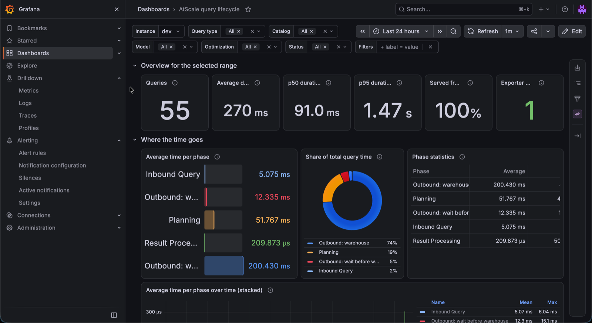
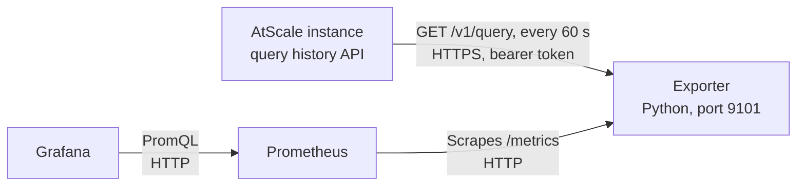

# AtScale query lifecycle monitoring

A Prometheus exporter and a Grafana dashboard that show where AtScale queries spend their time.

> This is sample code, provided as is under the MIT License. It is not an AtScale product and AtScale does not support it. Read [DISCLAIMER.md](DISCLAIMER.md) before you use it.

AtScale records four phases for every query: Inbound Query, Planning, Outbound and Result Processing. The exporter reads these phases from the AtScale query history API and turns them into Prometheus histograms. The dashboard then shows averages and percentiles per phase, catalog and model, so you can see which phase has the most impact on query performance.



## Contents

- [How it works](#how-it-works)
- [Requirements](#requirements)
- [Create the API token](#create-the-api-token)
- [Build the exporter image](#build-the-exporter-image)
- [Install on Kubernetes with Helm](#install-on-kubernetes-with-helm)
- [Run with Docker](#run-with-docker)
- [Import the Grafana dashboard](#import-the-grafana-dashboard)
- [Read the dashboard](#read-the-dashboard)
- [Drill down to single queries](#drill-down-to-single-queries)
- [Show the query text of one query](#show-the-query-text-of-one-query)
- [Show the trace of one query in Tempo](#show-the-trace-of-one-query-in-tempo)
- [Compare with a dashboard from engine telemetry only](#compare-with-a-dashboard-from-engine-telemetry-only)
- [Use Elasticsearch for logs](#use-elasticsearch-for-logs)
- [Find out why queries missed aggregates](#find-out-why-queries-missed-aggregates)
- [See the compression score of aggregate candidates](#see-the-compression-score-of-aggregate-candidates)
- [See the warehouse connection queue](#see-the-warehouse-connection-queue)
- [Configuration](#configuration)
- [Metrics](#metrics)
- [Limits](#limits)
- [Run the tests](#run-the-tests)
- [License](#license)

## How it works



The exporter polls the query history every minute. It counts each finished query once, by query ID, and adds its phase durations to the histograms. It reads only durations and these labels: instance name, catalog, model, status, query type, optimization and SQL dialect. It does not export user names or query text.

The exporter also writes one JSON line per query to its log, with the AtScale query ID. If a log store such as Loki collects that log, the dashboard lists single queries. See [Drill down to single queries](#drill-down-to-single-queries).

The phases come from AtScale. The exporter splits Outbound into two parts, because the split shows whether the warehouse or something before it is slow:

| Phase label | What it measures |
|---|---|
| `inbound` | Inbound Query: AtScale receives and parses the query from the BI tool |
| `planning` | Planning: AtScale plans the query and chooses aggregates |
| `outbound` | Outbound: total time of the outbound warehouse step |
| `warehouse` | Part of Outbound: wall time during which the warehouse subqueries ran. Parallel subqueries count once |
| `outbound_wait` | Part of Outbound: Outbound minus `warehouse`. Time before and between warehouse calls, for example waiting for a connection |
| `result_processing` | Result Processing: AtScale builds the result for the client |

## Requirements

| Component | Version | Note |
|---|---|---|
| AtScale | Container deployment with the `/v1/query` API | Tested with AtScale 2026.9 |
| Python | 3.12 | In the image (`python:3.12.7-slim`). Uses only the standard library |
| Prometheus | 2.x or 3.x | Any Prometheus that can scrape the exporter |
| Grafana | 10 or later | Tested with Grafana 13.2 |
| Helm | 3 or later | Only for the Kubernetes install. Tested with Helm 4.1 |
| Prometheus Operator | Optional | For the `ServiceMonitor` in the Helm chart, for example kube-prometheus-stack |

## Create the API token

The exporter calls the AtScale API with a bearer token. The token has the permissions of the user who created it, so use a dedicated service user, not a personal account.

The service user needs these permissions:

| Permission | Where | Why |
|---|---|---|
| Roles `queries_view`, `aggregates_view` and `repository_project_read` | User or group roles | Read the query history, the aggregates and the catalog export |
| Discover on every model you want to monitor | Security settings of each model | AtScale shows a query or an aggregate only for models the user can access. Discover lets the user see metadata without querying data |
| Data warehouse access on every connection those models use | Permissions of each data warehouse connection | AtScale hides a model if the user cannot access all of its connections |

If a model or a connection is missing, the exporter gets no error. Its queries and aggregates are left out, and the catalog export returns HTTP 403. Do not use a superuser: it sees everything but can also change licences and settings.

Put the permissions on a group, for example `atscale-query-monitoring`, and make the service user a member. When you add a model, add it to the group.

The query history that this token can read includes the user name of each query. The exporter does not write user names to its metrics or its log.

1. Create a group `atscale-query-monitoring` with the permissions in the table.
2. Create an AtScale user for the exporter, for example `svc-query-monitoring`.
3. Add the user to the group.
4. Log in to Design Center as that user.
5. Open the account menu and create an API token.
6. Store the token in your secret store. Do not commit it.
7. Run `curl -s -H "Authorization: Bearer $TOKEN" https://atscale.example.com/v1/catalogs`.

   Result: the list contains every catalog you want to monitor.

## Build the exporter image

1. Run `docker build -t registry.example.com/atscale-query-exporter:0.1.0 exporter/`.
2. Run `docker push registry.example.com/atscale-query-exporter:0.1.0`.

Replace `registry.example.com` with your own registry.

## Install on Kubernetes with Helm

The chart is in [deploy/helm/atscale-query-lifecycle](deploy/helm/atscale-query-lifecycle). It deploys one exporter pod and a `Service`. It can also add a `ServiceMonitor` and a dashboard `ConfigMap` for the Grafana sidecar.

1. Create the namespace: `kubectl create namespace atscale-monitoring`.
2. Create the token secret, one key per instance:

   ```bash
   kubectl create secret generic atscale-query-exporter-tokens -n atscale-monitoring \
     --from-literal=ATSCALE_TOKEN_PROD='<token>'
   ```

3. Create a file `my-values.yaml`:

   ```yaml
   image:
     repository: registry.example.com/atscale-query-exporter
   existingSecret: atscale-query-exporter-tokens
   instances:
     - name: prod
       url: https://atscale.example.com
   serviceMonitor:
     enabled: true
     labels: {release: kube-prometheus-stack}   # match your Prometheus serviceMonitorSelector
   dashboard:
     enabled: true                              # needs the Grafana dashboard sidecar
   ```

4. Run `helm install atscale-query-lifecycle deploy/helm/atscale-query-lifecycle -n atscale-monitoring -f my-values.yaml`.
5. Run `kubectl logs -n atscale-monitoring deploy/atscale-query-lifecycle`.

   Result: the log shows `prod: warm-up, N existing queries skipped`, then `prod: N new queries` every minute.

If the log shows `CERTIFICATE_VERIFY_FAILED`, AtScale uses a private or self-signed certificate. Put the CA certificate in a `ConfigMap` and set `caBundle.configMap`.

If you do not use the Prometheus Operator, keep `serviceMonitor.enabled: false` and add a scrape job for the service on port `9101`.

## Run with Docker

Use this on a VM or any host that can reach AtScale and that Prometheus can reach.

1. Copy `deploy/docker/exporter.env.example` to `deploy/docker/exporter.env`.
2. Set `ATSCALE_INSTANCES` and one `ATSCALE_TOKEN_<NAME>` per instance in `exporter.env`.
3. Run:

   ```bash
   docker run -d --name atscale-query-exporter --restart unless-stopped \
     --env-file deploy/docker/exporter.env -p 9101:9101 \
     registry.example.com/atscale-query-exporter:0.1.0
   ```

4. Run `curl -s localhost:9101/metrics | grep atscale_query_exporter_up`.

   Result: `atscale_query_exporter_up{env="prod"} 1`.

5. Add the job from `deploy/docker/prometheus-scrape.yaml` to your `prometheus.yml`.

If AtScale uses a private or self-signed certificate, mount the CA file with `-v /path/ca.crt:/etc/atscale-ca/ca.crt:ro` and set `CA_BUNDLE=/etc/atscale-ca/ca.crt`.

## Import the Grafana dashboard

Skip this section if the Helm chart installed the dashboard through the sidecar.

1. In Grafana, open Dashboards, then New, then Import.
2. Upload `dashboard/atscale-query-lifecycle.json`.
3. Click Import.
4. Select your Prometheus data source in the `Prometheus` list at the top of the dashboard.

Result: the dashboard "AtScale query lifecycle" opens. It fills as new queries run.

### Deploy with the Grafana Operator (GitOps, several clusters)

The folder `deploy/grafana-operator` has the dashboards as `GrafanaDashboard` resources (`grafana.integreatly.org/v1beta1`), with a `kustomization.yaml`:

- `atscale-query-lifecycle.yaml`: logs in Loki
- `atscale-query-lifecycle-es.yaml`: logs in Elasticsearch (see [Use Elasticsearch for logs](#use-elasticsearch-for-logs))

These variants are multi-cluster. They have a `Cluster` variable at the top, and every PromQL query filters on `cluster=~"$cluster"`. So one dashboard works on a central Grafana that reads the metrics of several Kubernetes clusters. Your Prometheus must put the label `cluster` on the exporter metrics, for example as an external label or with a relabeling on the scrape.

1. Copy the resources you need into your GitOps repository.
2. In each resource, set `instanceSelector.matchLabels` to the labels of your Grafana instance, and `folder` to your Grafana folder.
3. Set the namespace in `kustomization.yaml`.
4. Keep the annotation `kustomize.toolkit.fluxcd.io/substitute: disabled`. Without it, Flux replaces the `${...}` Grafana variables in the dashboard JSON.

The resources are generated: change the dashboards in `dashboard/generate*.py` and run `python3 dashboard/generate_grafana_operator.py`. Tested against the `GrafanaDashboard` schema of Grafana Operator v5.25.0. The cluster label and metric are set at the top of `generate_grafana_operator.py`.

## Read the dashboard

Start with Query type = `User`. `System` queries are AtScale's own queries, for example aggregate builds.

| What you see | What it usually points to |
|---|---|
| `warehouse` is the largest phase and few queries hit aggregates | Queries run on raw tables. Check aggregate definitions and the aggregate hit rate per model |
| `warehouse` is large although queries hit aggregates | The warehouse itself is slow or busy. Check warehouse size and queueing |
| `outbound_wait` is large | Time is lost before the warehouse runs, for example waiting for a connection. Check the AtScale connection pool settings and concurrent load |
| `planning` is large | The model or the query is complex, for example many calculated measures or deep hierarchies |
| `inbound` or `result_processing` is large | Very large queries or results. Check what the BI tool requests |

The table "Catalogs and models, slowest first" shows which model to look at first. The heatmap shows outliers. Find single slow queries on the Queries page in AtScale Design Center.

## Drill down to single queries

Prometheus holds the averages and percentiles, but not single queries. For single queries, the exporter writes one JSON line per query to standard output:

```json
{"event": "atscale_query", "query_id": "21b348fc-...", "env": "prod", "catalog": "Sales", "model": "Orders",
 "query_type": "User", "status": "successful", "optimization": "none", "miss_reason": "aggregate_created",
 "attributes": "CountryCity", "measures": "Average Sales per Order",
 "start": "2026-10-21T17:55:14.000Z",
 "duration_ms": 2585.4, "inbound_ms": 11.4, "planning_ms": 43.0, "outbound_ms": 2530.7,
 "outbound_wait_ms": 9.7, "warehouse_ms": 2521.0, "result_processing_ms": 0.4, "subqueries": 1}
```

The line has the names of the attributes and measures the query used, but no user names and no query text.

The table "Slowest queries" reads these lines from Loki. To use it:

1. Collect the exporter's container log in Loki, for example with Grafana Alloy or Promtail.
2. In the dashboard, select your Loki data source in the `Loki` list.
3. In `Log selector`, enter a LogQL stream selector that matches the exporter log. The default is `{container="exporter"}`.

   Result: "Slowest queries" lists one row per query, slowest first, with the same filters as the other panels.

4. Click a `Query ID` and select "Show query text". The panel "Query text" below the table shows the query text (see the next section). You can also search for the ID on the Queries page in AtScale Design Center.

If you use another log store, for example Elasticsearch or Splunk, filter on `"event": "atscale_query"` there. The other dashboard panels do not need Loki.

## Show the query text of one query

The AtScale query history API has no query text. The AtScale engine log has it. For each query, the engine logs the inbound query (`Received MDX query` for Excel and other MDX clients, `Received DAX query` for Power BI, `Received PGSQL query` for the SQL interface) and each outbound warehouse query (`Executing SQL Query`). Each log entry carries the query ID. The panel "Query text" shows these entries for the ID in the `Query ID` field at the top of the dashboard.

The engine writes the query text on the lines after the entry header. Most log collectors store each line as its own entry, which separates the text from its query ID. Configure your collector to join the lines first. For Grafana Alloy, add a `loki.process` stage for the engine container:

```alloy
loki.process "engine_multiline" {
  forward_to = [loki.write.default.receiver]
  stage.match {
    selector = "{container=\"engine\"}"
    stage.multiline {
      firstline     = "^\\d{4}-\\d{2}-\\d{2} \\d{2}:\\d{2}:\\d{2},\\d{3} "
      max_lines     = 2000
      max_wait_time = "3s"
    }
  }
}
```

Point the `forward_to` of your `loki.source.kubernetes` (or `loki.source.file`) at `loki.process.engine_multiline.receiver`. The stage applies only to log lines that arrive after the change.

The table "Warehouse connection queue for" under the query text shows how many warehouse queries the same query sent per connection, and the deepest place in the connection queue (see [See the warehouse connection queue](#see-the-warehouse-connection-queue)). It needs no multiline stage.

The engine log contains user names and the literal filter values of each query. Give access to the Loki data source only to people who may see them. The panel depends on the text of the engine log messages, which can change between AtScale releases.

## Show the trace of one query in Tempo

The AtScale engine sends an OpenTelemetry trace for every query to the AtScale telemetry collector. Each trace has a root span named after the query ID, with the model and catalog IDs, the user, the query type and the inbound query text (event `QueryReceivedEvent`). Below it are a planning span, an execution span and one span per warehouse query. Grafana shows the trace as a waterfall, so you see which warehouse queries ran in parallel and which one took longest.

By default the AtScale collector writes the traces only to files on its disk. To see them in Grafana:

1. Install Grafana Tempo and add it as a Grafana data source.
2. Give the AtScale collector a configuration that also exports traces to Tempo: copy the chart's collector configuration (ConfigMap `<release>-telemetry`, key `relay`) into your own ConfigMap, add an `otlp` exporter that points at Tempo to the `traces` pipeline, and set `telemetry.configMap.existingName` to that ConfigMap in your AtScale values. Upgrading the AtScale release restarts its pods.
3. In the dashboard, select your Tempo data source in the `Tempo` list.
4. In "Slowest queries", click a `Query ID` and select "Show trace (Tempo)".

   Result: Grafana Explore opens a search for the trace. Select the trace to see the waterfall.

The traces contain user names and the inbound query text, but no outbound SQL. Re-check your collector configuration after each AtScale chart upgrade, because your ConfigMap replaces the chart's configuration.

## Compare with a dashboard from engine telemetry only

The dashboard "AtScale queries from engine telemetry" (`dashboard/atscale-query-lifecycle-engine.json`) uses no exporter and no AtScale API. It reads the engine traces in Tempo (TraceQL metrics and search) and the engine log in Loki. Its last panel lists what it cannot show compared with the exporter dashboard, for example model names and the reason for an aggregate miss.

It needs:

- The trace export to Tempo from the previous section. Add the resource attribute `k8s.namespace.name` in the collector (a `resource` processor on the `traces` pipeline). The dashboard filters traces and engine logs by namespace.
- The Tempo metrics generator with the `local-blocks` processor, for TraceQL metrics. Set `query_frontend.metrics.max_duration` to your retention, because the default allows only 3 hours per query.
- Loki with the engine log, joined to multi-line entries.

With the Helm chart, set `dashboard.engineTelemetry: true` to ship it next to the main dashboard. To change it, edit `dashboard/generate_engine.py` and run `python3 dashboard/generate_engine.py`.

## Use Elasticsearch for logs

If you keep logs in Elasticsearch and metrics in Prometheus, use the dashboard "AtScale query lifecycle (Elasticsearch logs)" (`dashboard/atscale-query-lifecycle-elasticsearch.json`). It has the same Prometheus panels. Every panel that reads Loki in the main dashboard reads Elasticsearch instead. Tested with Elasticsearch and Elastic Agent 8.19 and Grafana 13.2.

The folder `deploy/elastic` has what Elasticsearch needs. The ingest pipelines parse the logs when they arrive. That replaces the LogQL parsing in the Loki dashboard.

| File | Purpose |
|---|---|
| `pipeline-atscale-engine.json` | Ingest pipeline for the engine log: query ID, inbound and outbound query text, queue place, connection, aggregate candidate score, dataset and grain |
| `pipeline-atscale-exporter.json` | Ingest pipeline for the exporter's JSON lines, plus the runtime bucket and the join key the dashboard needs |
| `component-template-atscale-logs-mappings.json` | Field types for the `atscale.*` fields |
| `index-template-logs-atscale.json` | Index template for the data streams `logs-atscale.*-*` |
| `agent-inputs.yml` | Elastic Agent inputs for the engine and exporter containers, with the multiline setting for the engine log |
| `filebeat-autodiscover.yml` | The same for Filebeat 8.x: autodiscover templates with index, pipeline and multiline setting |

To set it up:

1. Load the pipelines:
   `PUT _ingest/pipeline/atscale-engine` with `pipeline-atscale-engine.json`, and `PUT _ingest/pipeline/atscale-exporter` with `pipeline-atscale-exporter.json`.
2. Load the field types: `PUT _component_template/atscale-logs@mappings` with `component-template-atscale-logs-mappings.json`.
3. Optional: put your retention policy and replica count into `PUT _component_template/atscale-logs@settings`.
4. Load the index template: `PUT _index_template/logs-atscale` with `index-template-logs-atscale.json`.
5. Add the inputs from `agent-inputs.yml` to your Elastic Agent policy, or the templates from `filebeat-autodiscover.yml` to your Filebeat autodiscover configuration.

   Result: documents arrive in `logs-atscale.engine-default` and `logs-atscale.exporter-default`.

6. In Grafana, add two Elasticsearch data sources with the time field `@timestamp`. Name them so that they contain "engine" and "exporter". The dashboard finds them by name.

   | Data source | Index | Log message field |
   |---|---|---|
   | Engine log | `logs-atscale.engine-*` | `atscale.msg` |
   | Exporter | `logs-atscale.exporter-*` | `message` |

7. Import the dashboard and select the two data sources at the top.

Load the pipelines (step 1) before the agent sends data. Documents that arrive earlier are stored without the `atscale.*` fields.

To filter the engine log by namespace, enter a Lucene query in `Engine log filter`, for example `kubernetes.namespace:atscale`. The ingest pipelines compute the runtime and score buckets that `dashboard/generate.py` uses. If you change the buckets there, change the scripts in both pipelines too. With the Helm chart, set `dashboard.elasticsearch: true` to ship this dashboard.

## Find out why queries missed aggregates

When a query uses neither an aggregate nor the cache, the exporter gives it a reason in the label `miss_reason`. For queries that reached the warehouse, it reads the aggregates of the query's model from the AtScale aggregates API (`/v1/aggregates`), once per poll and only for models with such queries.

| Reason | Meaning | What to do |
|---|---|---|
| `aggregate_created` | AtScale created an aggregate for the model while the query ran. This is the first run of a new combination of attributes and measures | Nothing. The next run of this combination can use the aggregate |
| `no_aggregate_created` | The query read the raw tables and AtScale created no aggregate | Investigate. A common cause is an exact distinct count, which no system aggregate holds. Read the outbound SQL of the query on the Queries page in Design Center |
| `no_warehouse` | AtScale answered without a warehouse query, for example a metadata query | Nothing |
| `system` | AtScale's own queries, for example aggregate builds and statistics | Nothing |
| `failed` | The query failed | Check the error on the Queries page |
| `unclassified` | The exporter could not read the aggregates API | Check the exporter log and the token permissions |
| `optimized` | The query used an aggregate or the cache | Nothing |

The panel "Queries without aggregate or cache, by reason" and the table "Misses by catalog, model and reason" show the counts. The table "Slowest queries" shows the reason for each query.

The classification is a rule, not a statement from AtScale. An aggregate counts as created by the query if it was created from 5 seconds before the query started until 10 seconds after it ended. An aggregate that a catalog deployment creates at the same moment also counts.

## See the compression score of aggregate candidates

When AtScale proposes an aggregate, the engine logs a compression score for the candidate: the rows in the fact dataset divided by the estimated rows of the aggregate. If the engine setting `aggregates.create.threshold.enabled` is on, AtScale does not create candidates below `aggregates.create.compression.threshold` (default 3.0). A low score means the aggregate would be about as large as the fact dataset, for example an aggregate at the same grain as a daily fact table.

The row "Aggregate candidates and compression score" shows these scores. It reads the AtScale engine log, not the exporter. To use it:

1. Collect the AtScale engine container log in Loki.
2. In `Engine log selector`, enter a LogQL stream selector for the engine log of one AtScale instance. The default is `{container="engine"}`.
3. In `Compression threshold`, enter the value of `aggregates.create.compression.threshold` from Settings > Engine in Design Center. The default is `3`.

   Result: "Aggregate candidates by dataset and grain" lists each fact dataset and aggregate grain with its score. "Below threshold" counts the candidates that AtScale did not create because of the threshold.

Two panels combine both logs, joined on the query ID:

- "Unoptimized queries by runtime and compression score" counts queries without aggregate or cache by runtime range (rows) and by the compression score of their candidates (columns). A bar chart next to it shows the same counts. Narrow them with `Min runtime (ms)`, `Max runtime (ms)`, `Min compression score` and `Max compression score`.
- "Aggregate suggestions for slow queries" lists the queries in the runtime range with their candidates below the threshold, one row per query and fact dataset. The column UDA (SML) holds the `aggregates:` block for that fact dataset, which you can add to the model file. The exporter writes these blocks as separate log lines (`"event": "atscale_uda_suggestion"`, one per query and fact dataset).

The exporter builds that block from the catalog export (`/v1/catalogs/{id}/export`, read at most once an hour per catalog):

- One user-defined aggregate per fact dataset that the query's measures use. A calculation is replaced by the base metrics it references, so a ratio of two fact datasets gives two aggregates.
- The query's attributes with their dimension. An attribute whose dimension has no relationship to the fact dataset is left out of that aggregate, with a comment.
- Calculation groups and engine-internal measures are left out, with a comment.
- A query without measures that still reached the warehouse reads a fact dataset to find which attribute combinations exist. SML needs at least one metric, so the block has one aggregate per fact dataset that relates to all the attributes, each with one metric of that dataset. Keep the one on the fact dataset that the dashboard shows for the query.

Example for Store Sales Index to Chain by Franchisee, Fiscal Quarter and Store Format. The two aggregates appear in two rows, one per fact dataset; here they are shown together:

```yaml
# left out Franchisee: Store Dimension has no relationship to FACT_CHAIN_DAY
# left out Store Format: Store Dimension has no relationship to FACT_CHAIN_DAY
aggregates:
  - unique_name: uda_2ca5580d
    label: "Suggested on FACT_CHAIN_DAY: Fiscal Quarter"
    attributes:
      - name: Fiscal Quarter
        dimension: Retail Calendar Dimension
    metrics:
      - Chain Net Sales
      - Chain Store Days
  - unique_name: uda_505357d0
    label: "Suggested on FACT_STORE_SALES_DAY: Fiscal Quarter, Franchisee, Store Format"
    attributes:
      - name: Fiscal Quarter
        dimension: Retail Calendar Dimension
      - name: Franchisee
        dimension: Store Dimension
      - name: Store Format
        dimension: Store Dimension
    metrics:
      - Net Sales
      - Store Days Traded
```

Before you add a suggestion to the model:

1. Check that the attributes are coarser than the rejected grain, for example Fiscal Quarter instead of Day. Otherwise the aggregate has the same low compression.
2. If the model file already has an `aggregates:` key, add only the list items.
3. Run `sml-cli validate` on the repository.

Queries that used an aggregate have no candidates and do not appear in these panels.

The engine log has no catalog or model name, so only the time range filters the candidate panels. The panels depend on the text of an engine log message (rule `R050`), which can change between AtScale releases.

## See the warehouse connection queue

Each warehouse query asks the AtScale connection manager for a connection to the data warehouse. The engine logs each request with its place in line. Place 1 means the request was first in line; a higher place means it waited behind other requests. User queries share the connection with AtScale's own services, such as statistics, aggregate builds and health checks.

The row "Warehouse connection queue" shows:

- the deepest place in line per interval and connection,
- the requests that queued behind others, by requester (User query or an AtScale service),
- a table per connection and requester with the number of requests, how many queued and the deepest place.

A deep queue for user queries explains a high Outbound wait. Typical causes are many parallel queries from one dashboard refresh, or a low connection limit for the warehouse connection in AtScale.

These panels read the same AtScale engine log as the compression score panels (`Engine log selector`). Only the time range filters them. They depend on the text of the engine log message "going into queue, is [#N] in line", which can change between AtScale releases.

## Configuration

Environment variables of the exporter. The Helm chart sets them from `values.yaml`.

| Variable | Default | Meaning |
|---|---|---|
| `ATSCALE_INSTANCES` | none, required | Comma list of `name=url`, for example `prod=https://atscale.example.com` |
| `ATSCALE_TOKEN_<NAME>` | none, required | API token per instance. `NAME` is the instance name in upper case, other characters become `_` (`prod-eu` → `ATSCALE_TOKEN_PROD_EU`) |
| `QUERY_PATH` | `/v1/query` | Use `/v1/public/query` when the URL points at the AtScale `sml-api` service inside Kubernetes |
| `CA_BUNDLE` | none | PEM file with extra CA certificates. Certificate checks stay on |
| `POLL_SECONDS` | `60` | Poll interval |
| `LOOKBACK_MINUTES` | `30` | How far back each poll reads. Queries that run longer are missed |
| `AGGREGATES_PATH` | `QUERY_PATH` with `query` replaced by `aggregates` | Path of the aggregates API, used for `miss_reason` |
| `PAGE_SIZE`, `MAX_PAGES` | `100`, `20` | Paging of the AtScale APIs. The APIs return at most 101 rows per page, so values above 100 are reduced to 100 |
| `HTTP_TIMEOUT_SECONDS` | `30` | Timeout per API call |
| `PORT` | `9101` | Port of `/metrics` |
| `QUERY_LOG` | `true` | Write one JSON line per query to standard output, for drill-down in a log store |
| `CATALOGS_PATH` | `QUERY_PATH` with `query` replaced by `catalogs` | Path of the catalog API, used for the UDA suggestion |
| `CATALOG_CACHE_MINUTES` | `60` | How long the exporter reuses a catalog export |

## Metrics

| Metric | Type | Labels |
|---|---|---|
| `atscale_query_duration_seconds` | Histogram | `env`, `catalog`, `model`, `status`, `query_type`, `optimization`, `dialect`, `miss_reason` |
| `atscale_query_phase_duration_seconds` | Histogram | Same, plus `phase` |
| `atscale_query_subqueries` | Histogram | Same as the first metric |
| `atscale_query_exporter_up` | Gauge | `env`. 1 when the last poll succeeded |
| `atscale_query_exporter_last_success_timestamp_seconds` | Gauge | `env` |
| `atscale_query_exporter_poll_errors_total` | Counter | `env` |

## Limits

- Data starts when the exporter starts. Queries that are already in the query history at start are skipped, so a restart does not count them twice. There is no back-fill.
- Run exactly one exporter per set of instances. Two exporters count every query twice.
- History in Grafana is as long as your Prometheus retention.
- Percentiles are estimates from histogram buckets.
- The field names of the query history API can change between AtScale releases. If they change, the exporter logs a warning and records only total durations.

## Run the tests

1. Run `python3 -m unittest discover -s exporter`.

   Result: `OK`.

2. If you change the dashboard, edit `dashboard/generate.py` and run `python3 dashboard/generate.py`. It writes the dashboard JSON and the copy in the Helm chart.

## License

MIT, see [LICENSE](LICENSE). Provided as is, without warranty and without support. See [DISCLAIMER.md](DISCLAIMER.md).
