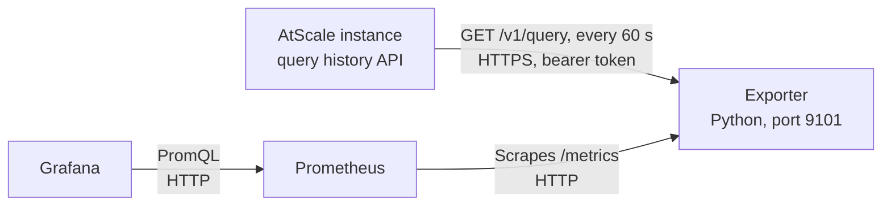

# AtScale query lifecycle monitoring

A Prometheus exporter and a Grafana dashboard that show where AtScale queries spend their time.

> This is sample code, provided as is under the MIT License. It is not an AtScale product and AtScale does not support it. Read [DISCLAIMER.md](DISCLAIMER.md) before you use it.

AtScale records four phases for every query: Inbound Query, Planning, Outbound and Result Processing. The exporter reads these phases from the AtScale query history API and turns them into Prometheus histograms. The dashboard then shows averages and percentiles per phase, catalog and model, so you can see which phase has the most impact on query performance.

## Contents

- [How it works](#how-it-works)
- [Requirements](#requirements)
- [Create the API token](#create-the-api-token)
- [Build the exporter image](#build-the-exporter-image)
- [Install on Kubernetes with Helm](#install-on-kubernetes-with-helm)
- [Run with Docker](#run-with-docker)
- [Import the Grafana dashboard](#import-the-grafana-dashboard)
- [Read the dashboard](#read-the-dashboard)
- [Configuration](#configuration)
- [Metrics](#metrics)
- [Limits](#limits)
- [Run the tests](#run-the-tests)
- [License](#license)

## How it works



The exporter polls the query history every minute. It counts each finished query once, by query ID, and adds its phase durations to the histograms. It reads only durations and these labels: instance name, catalog, model, status, query type, optimization and SQL dialect. It does not export user names or query text.

The phases come from AtScale. The exporter splits Outbound into two parts, because the split shows whether the warehouse or something before it is slow:

| Phase label | What it measures |
|---|---|
| `inbound` | Inbound Query: AtScale receives and parses the query from the BI tool |
| `planning` | Planning: AtScale plans the query and chooses aggregates |
| `outbound` | Outbound: total time of the outbound warehouse step |
| `warehouse` | Part of Outbound: wall time during which the warehouse subqueries ran. Parallel subqueries count once |
| `outbound_wait` | Part of Outbound: Outbound minus `warehouse`. Time before and between warehouse calls, for example waiting for a connection |
| `result_processing` | Result Processing: AtScale builds the result for the client |

## Requirements

| Component | Version | Note |
|---|---|---|
| AtScale | Container deployment with the `/v1/query` API | Tested with AtScale 2026.9 |
| Python | 3.12 | In the image (`python:3.12.7-slim`). Uses only the standard library |
| Prometheus | 2.x or 3.x | Any Prometheus that can scrape the exporter |
| Grafana | 10 or later | Tested with Grafana 13.2 |
| Helm | 3 or later | Only for the Kubernetes install. Tested with Helm 4.1 |
| Prometheus Operator | Optional | For the `ServiceMonitor` in the Helm chart, for example kube-prometheus-stack |

## Create the API token

The exporter calls the AtScale API with a bearer token. Use a dedicated service user, not a personal account.

1. Create an AtScale user for the exporter, for example `svc-query-monitoring`.
2. Give the user access to the query history of the catalogs you want to monitor.
3. Log in to Design Center as that user.
4. Open the account menu and create an API token.
5. Store the token in your secret store. Do not commit it.

## Build the exporter image

1. Run `docker build -t registry.example.com/atscale-query-exporter:0.1.0 exporter/`.
2. Run `docker push registry.example.com/atscale-query-exporter:0.1.0`.

Replace `registry.example.com` with your own registry.

## Install on Kubernetes with Helm

The chart is in [deploy/helm/atscale-query-lifecycle](deploy/helm/atscale-query-lifecycle). It deploys one exporter pod and a `Service`. It can also add a `ServiceMonitor` and a dashboard `ConfigMap` for the Grafana sidecar.

1. Create the namespace: `kubectl create namespace atscale-monitoring`.
2. Create the token secret, one key per instance:

   ```bash
   kubectl create secret generic atscale-query-exporter-tokens -n atscale-monitoring \
     --from-literal=ATSCALE_TOKEN_PROD='<token>'
   ```

3. Create a file `my-values.yaml`:

   ```yaml
   image:
     repository: registry.example.com/atscale-query-exporter
   existingSecret: atscale-query-exporter-tokens
   instances:
     - name: prod
       url: https://atscale.example.com
   serviceMonitor:
     enabled: true
     labels: {release: kube-prometheus-stack}   # match your Prometheus serviceMonitorSelector
   dashboard:
     enabled: true                              # needs the Grafana dashboard sidecar
   ```

4. Run `helm install atscale-query-lifecycle deploy/helm/atscale-query-lifecycle -n atscale-monitoring -f my-values.yaml`.
5. Run `kubectl logs -n atscale-monitoring deploy/atscale-query-lifecycle`.

   Result: the log shows `prod: warm-up, N existing queries skipped`, then `prod: N new queries` every minute.

If the log shows `CERTIFICATE_VERIFY_FAILED`, AtScale uses a private or self-signed certificate. Put the CA certificate in a `ConfigMap` and set `caBundle.configMap`.

If you do not use the Prometheus Operator, keep `serviceMonitor.enabled: false` and add a scrape job for the service on port `9101`.

## Run with Docker

Use this on a VM or any host that can reach AtScale and that Prometheus can reach.

1. Copy `deploy/docker/exporter.env.example` to `deploy/docker/exporter.env`.
2. Set `ATSCALE_INSTANCES` and one `ATSCALE_TOKEN_<NAME>` per instance in `exporter.env`.
3. Run:

   ```bash
   docker run -d --name atscale-query-exporter --restart unless-stopped \
     --env-file deploy/docker/exporter.env -p 9101:9101 \
     registry.example.com/atscale-query-exporter:0.1.0
   ```

4. Run `curl -s localhost:9101/metrics | grep atscale_query_exporter_up`.

   Result: `atscale_query_exporter_up{env="prod"} 1`.

5. Add the job from `deploy/docker/prometheus-scrape.yaml` to your `prometheus.yml`.

If AtScale uses a private or self-signed certificate, mount the CA file with `-v /path/ca.crt:/etc/atscale-ca/ca.crt:ro` and set `CA_BUNDLE=/etc/atscale-ca/ca.crt`.

## Import the Grafana dashboard

Skip this section if the Helm chart installed the dashboard through the sidecar.

1. In Grafana, open Dashboards, then New, then Import.
2. Upload `dashboard/atscale-query-lifecycle.json`.
3. Click Import.
4. Select your Prometheus data source in the `Prometheus` list at the top of the dashboard.

Result: the dashboard "AtScale query lifecycle" opens. It fills as new queries run.

## Read the dashboard

Start with Query type = `User`. `System` queries are AtScale's own queries, for example aggregate builds.

| What you see | What it usually points to |
|---|---|
| `warehouse` is the largest phase and few queries hit aggregates | Queries run on raw tables. Check aggregate definitions and the aggregate hit rate per model |
| `warehouse` is large although queries hit aggregates | The warehouse itself is slow or busy. Check warehouse size and queueing |
| `outbound_wait` is large | Time is lost before the warehouse runs, for example waiting for a connection. Check the AtScale connection pool settings and concurrent load |
| `planning` is large | The model or the query is complex, for example many calculated measures or deep hierarchies |
| `inbound` or `result_processing` is large | Very large queries or results. Check what the BI tool requests |

The table "Catalogs and models, slowest first" shows which model to look at first. The heatmap shows outliers. Find single slow queries on the Queries page in AtScale Design Center.

## Configuration

Environment variables of the exporter. The Helm chart sets them from `values.yaml`.

| Variable | Default | Meaning |
|---|---|---|
| `ATSCALE_INSTANCES` | none, required | Comma list of `name=url`, for example `prod=https://atscale.example.com` |
| `ATSCALE_TOKEN_<NAME>` | none, required | API token per instance. `NAME` is the instance name in upper case, other characters become `_` (`prod-eu` → `ATSCALE_TOKEN_PROD_EU`) |
| `QUERY_PATH` | `/v1/query` | Use `/v1/public/query` when the URL points at the AtScale `sml-api` service inside Kubernetes |
| `CA_BUNDLE` | none | PEM file with extra CA certificates. Certificate checks stay on |
| `POLL_SECONDS` | `60` | Poll interval |
| `LOOKBACK_MINUTES` | `30` | How far back each poll reads. Queries that run longer are missed |
| `PAGE_SIZE`, `MAX_PAGES` | `500`, `20` | Paging of the query history API |
| `HTTP_TIMEOUT_SECONDS` | `30` | Timeout per API call |
| `PORT` | `9101` | Port of `/metrics` |

## Metrics

| Metric | Type | Labels |
|---|---|---|
| `atscale_query_duration_seconds` | Histogram | `env`, `catalog`, `model`, `status`, `query_type`, `optimization`, `dialect` |
| `atscale_query_phase_duration_seconds` | Histogram | Same, plus `phase` |
| `atscale_query_subqueries` | Histogram | Same as the first metric |
| `atscale_query_exporter_up` | Gauge | `env`. 1 when the last poll succeeded |
| `atscale_query_exporter_last_success_timestamp_seconds` | Gauge | `env` |
| `atscale_query_exporter_poll_errors_total` | Counter | `env` |

## Limits

- Data starts when the exporter starts. Queries that are already in the query history at start are skipped, so a restart does not count them twice. There is no back-fill.
- Run exactly one exporter per set of instances. Two exporters count every query twice.
- History in Grafana is as long as your Prometheus retention.
- Percentiles are estimates from histogram buckets.
- The field names of the query history API can change between AtScale releases. If they change, the exporter logs a warning and records only total durations.

## Run the tests

1. Run `python3 -m unittest discover -s exporter`.

   Result: `OK`.

2. If you change the dashboard, edit `dashboard/generate.py` and run `python3 dashboard/generate.py`. It writes the dashboard JSON and the copy in the Helm chart.

## License

MIT, see [LICENSE](LICENSE). Provided as is, without warranty and without support. See [DISCLAIMER.md](DISCLAIMER.md).
